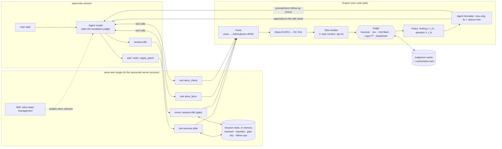

# Agent-first ArkUI semantic lint: opencode plugin design

Architecture, agentic evaluation and risks of the opencode plugin. Condensed on 2026-10-08. Section numbers are the original ones.
Status and roadmap (P-A steps): `docs/exec-plans/active/roadmap.md`.

Tags:
- **[V]** verified (docs or package types, or run here);
- **[V-vendor]** vendor-reported;
- **[I]** my inference;
- **[H]** hypothesis.

Date: 2026-10-05.

**Target:** opencode v1 (tested against opencode 1.18.30 and `@opencode-ai/plugin` 1.18.34).

The working prototype is in [`arkui-sem/`](../../arkui-sem/).

---

## 3. Architecture



**One turn, as the prototype runs it:**

```mermaid
sequenceDiagram
  participant A as Agent
  participant T as edit tool
  participant P as tool.execute.after
  participant E as Engine
  participant G as session.idle gate
  A->>T: edit entry/.../Feed.ets
  T-->>P: input.args.filePath, output.output
  P->>E: check(Feed.ets)
  E-->>P: 1 finding, 1 question (new)
  P-->>A: edit result + "fix @State items; is lastFetchMs meant to update the UI?"
  A->>T: edit (adds @State; disables R1 on lastFetchMs with reason)
  A->>G: turn ends (session.idle)
  G->>E: check(all touched .ets)
  E-->>G: 0 confident findings
  Note over G: no follow-up
```

### Agent-specific design decisions

1. **D1 — The agent is the escalation judge.** Mid-band cases go to the agent as *questions*, because it knows the task (Rung-2 intent) [H; tested by the A-arms].
2. **D2 — Precision first.** Only findings at or above τ_hi assert; questions never trigger the gate. τ is calibrated per rule offline (MDP, ArkState-200) before live runs.
3. **D3 — New-only feedback.** Each finding is reported once per session; the gate re-checks every touched file.
4. **D4 — Loop safety.** One follow-up per distinct set of confident findings, at most 3 per session. After that the plugin only logs.
5. **D5 — Degrade, don't break.** Judge timeout or error → *question* (deterministic facts only). Exceptions are caught; the tool result is left untouched.
6. **D6 — Determinism.** A judgment cache keyed by (backend, slice, questions).
7. **D7 — Dismissals are data.** Disable comments with reasons, and agent fixes, become labels (P-A2).
8. **D8 — Intent-aware slices (opt-in).** The slice can carry the user's task text; off by default (privacy) (P-A5).
9. **D9 — Two latency tiers.** Post-edit uses fast facts and a fast backend; the gate and CI use full analysis.
10. **D10 — Feedback carries no code excerpts.** The agent sees identifiers, lines and fixes. Excerpts go only to the judge.
11. **D11 — In-process daemon.** opencode plugins live in the long-running server process, so the ArkAnalyzer scene (P-A3) can be built once and updated incrementally. Unlike a hook-per-process design, this needs no IPC.

---

## 6. Evaluation, agent-first

**Primary question:** with the plugin, does a coding agent produce more correct ArkTS, without unacceptable harm or overhead?

### 6.1 Outcome metrics

| Metric | Definition |
|---|---|
| **Task success** | Hidden checks / reproduction tests pass (and Compile@1) |
| **Defects introduced** | Semantic defects in the final diff (R1–R4 classes), found by an *expert-tier* checker plus human review. This checker is stronger than the plugin under test: ArkAnalyzer facts, Sonnet-class escalation, manual triage. |
| **Finding resolution** | Share of confident findings the agent fixed *correctly* |
| **Harmful edits** | Agent changes that break previously correct behaviour because of a false finding or question |
| **Dismissal correctness** | Share of disable comments whose reason a reviewer accepts (watch for silencing instead of fixing) |
| **Overhead** | Wall time, turns, tokens (incl. appended feedback), backend $, per-edit check latency |
| **Loop incidents** | Sessions where the gate fired 3 times, or the agent oscillated on the same finding |

Transcripts for these metrics come from `opencode export <sessionID>` (session JSON). Token and cost figures come from `opencode stats` or the exported messages.

### 6.2 Task suites

| Suite | Content | Oracle |
|---|---|---|
| **S1 ArkEval repair** | Subset touching R1–R3 (by fix-diff signature) + a random control subset (harm) | ArkEval reproduction tests |
| **S2 Trap tasks** (30–60) | Feature tasks in fixture apps built to elicit the bug classes: "show the item count after an async load", "child editor that updates the parent's selection", "poll every second while the page is visible", "toggle a nested setting" | Hidden checks: static assertions on the final code + a UiTest where feasible |
| **S3 Your history** | Re-issue real feature/fix commits from your big project as tasks | Existing tests + expert review against the real commit |
| **S4 V1→V2 migration** | Migrate components to `@ComponentV2` | Compile + behavioural checks + R2 intent review |

Start with S2, which is the cheapest. Pilot it to estimate variance before sizing S1/S3.

### 6.3 Methods

1. **A0 — Offline gates.** These are E0–E5 from the evaluation plan; their thresholds must hold before any live run.
2. **A1 — Trajectory replay (counterfactual, cheap).**
   - Run the agent **without** the plugin, but with a logging-only variant (`ARKUI_SEM_GATE=false` and output suppressed) that snapshots every `.ets` file after each edit.
   - Replay the linter on the snapshots offline.
   - Measure:
     - early-warning recall;
     - noise on successful runs;
     - when flags would have fired.

   One set of agent runs serves every backend and threshold.
3. **A2/A3 — Live A/B harness on `opencode serve` + `@opencode-ai/sdk`.**
   - **Workspace:** a fresh git worktree of the task's base revision per run.
   - **Arm setup** with `scripts/install.mjs`: full plugin, `--skill-only`, or nothing. The no-plugin arm can also use `opencode --pure`, which runs without external plugins; check that it also skips local plugin files, or simply don't install the shim.
   - **Driving the run:**
     - start `opencode serve --port …` in the worktree;
     - via the SDK, create a session and send the task prompt;
     - wait for `session.idle`, *including* any gate follow-up turns;
     - export the session.
   - **Grading** happens outside the agent: hvigor build, reproduction tests / hidden checks, and the expert-tier checker on the final diff.
   - **Environment:** Linux or WSL2 is easiest for the HarmonyOS command-line tools and hvigor. opencode itself runs on Windows, as verified here.

### 6.4 Arms (ablations)

| Arm | What it isolates |
|---|---|
| No plugin | Baseline |
| **Skill only** (`--skill-only`) | Knowledge without feedback. **The critical control**: if it captures most of the gain, the hooks/judge add little. |
| Skill + post-edit feedback (`ARKUI_SEM_GATE=false`) | Value of per-edit feedback |
| + idle gate (default) | Value of the gate (and its overhead) |
| LSP channel instead of `tool.execute.after` (P-A4) | Channel effect |
| Tools on/off (`arkui_facts`, `arkui_check`) | Value of agent-queryable facts |
| Backend: heuristic / Jev / Clef-flash / Laya-FT / DeepSeek (structured) | Does the decision model matter *in the loop*? |
| Intent-aware on/off (P-A5) | Value of task context |
| Agent model: 2–3 models you use in opencode | Cheaper agents may benefit more [H] |

### 6.5 Statistics

- **Pair by task**, with k ≥ 3 seeds per task × arm.
- Analyse with a mixed-effects logistic regression (task random intercept) or a paired bootstrap over tasks. McNemar on per-task majority outcomes is a simple check.
- Report effects with CIs.
- **Rough sizing [I]:** detecting a +10-pt change in success needs on the order of 100–150 tasks × 3 seeds. Pilot S2 first.

### 6.6 Go / no-go

The plugin is worth keeping if, versus the **skill-only** arm:
- semantic defects introduced fall by ≥ 30%, **or** task success rises by ≥ 5 pts, with the CI excluding 0;
- the harmful-edit rate is no worse than +1 pt;
- overhead is ≤ +15% wall time and ≤ +10% tokens;
- there are zero loop incidents;
- per-edit check p95 is ≤ 1.5 s.

If skill-only ≈ the full plugin, ship the skill and keep the linter for CI.

### 6.7 Cost and environment

- **Agent runs dominate cost.** Roughly tasks × seeds × arms × (model cost per run). Judge calls are negligible with Jev, Clef-flash or Laya.
- **Proprietary code:** use `heuristic` or a self-hosted Clef/Laya; hosted Jev only for public code.

---

## 7. Risks specific to the agent loop

| Risk | Mitigation |
|---|---|
| A false finding makes the agent break correct code | Precision-first bands (D2); harmful-edit metric; questions never assert |
| The agent silences instead of fixing | A reason is required; dismissal-correctness metric; the label log surfaces suppressions (P-A2) |
| Nagging / token bloat | New-only feedback (D3); short format; no excerpts (D10) |
| Gate loops | D4; loop-incident metric |
| The gate's follow-up is lost under `opencode run` | Run gate experiments through `opencode serve` + SDK and wait for the follow-up turn [I] |
| Latency on big projects | Warm in-process analysis (D11), two tiers (D9) |
| The edit result format changes across opencode versions | We only *append* to `output.output`; pin the opencode version per experiment |
| Skill alone is enough | That's a legitimate result; the skill-only arm detects it |
| Backend data exposure | Offline default; backend per org; task context opt-in (D8) |
