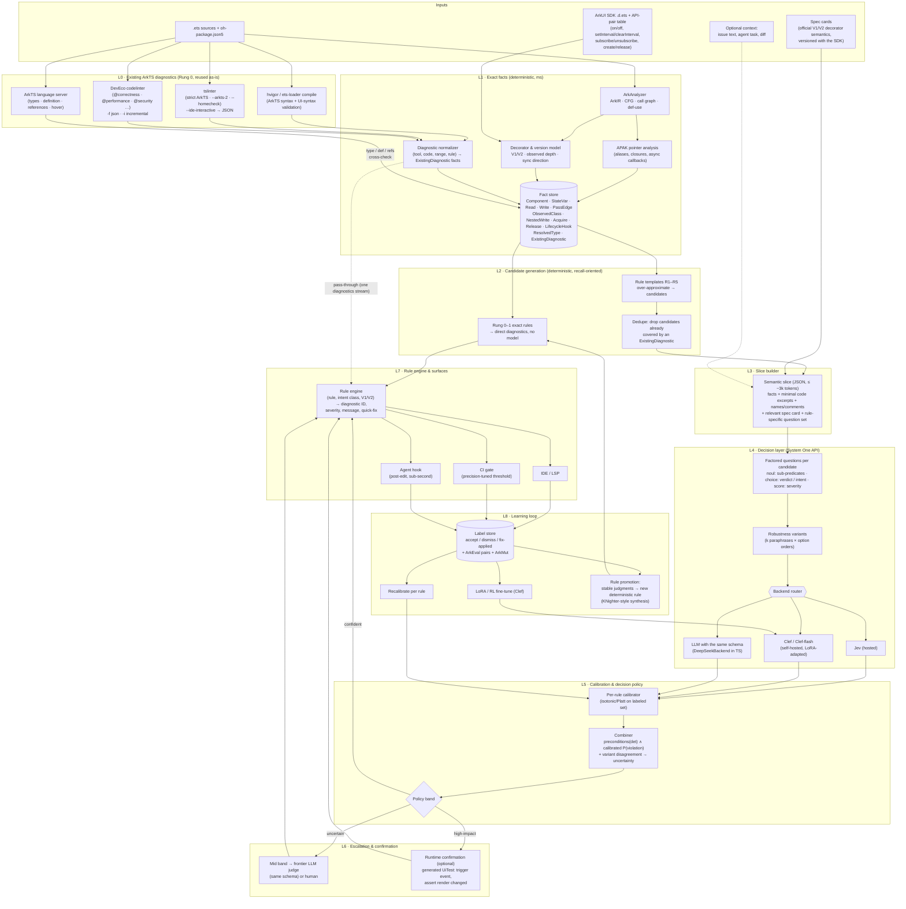
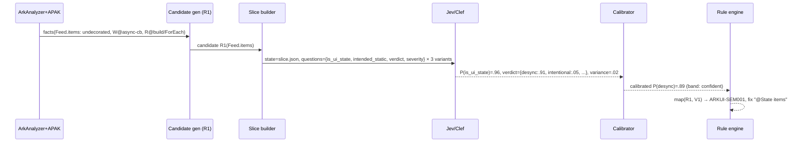

# Core beliefs: decidability ladder, architecture, evaluation hygiene, risks

The living part of the 2026-10-05 deep dive (removed). Condensed on 2026-10-08. Section numbers are the original ones.
Dropped: the claim check of the initial report, the prototype list (superseded by the roadmap), new ideas, suggested report edits.

Evidence tags used throughout:

- **[V]** verified in a primary source (paper text, official docs, vendor post).
- **[V-vendor]** stated only by the vendor (TypeSafe / Cloudflare).
- **[V-3p]** independent third-party measurement, usually small.
- **[I]** my inference from verified facts.
- **[H]** hypothesis — untested; the prototypes below exist to test these.

---

### 2.4 ArkTS tooling you can build on [V]

- **ArkAnalyzer** (ICSE-SEIP '25): the official OpenHarmony static-analysis framework.
  - It provides ArkTS-aware IR, CFG, def-use chains, type inference and call graphs (CHA/RTA), with ArkUI decorator support. Most apps are analyzed in under 1 s.
  - TAJS/ESLint failed on thousands of ArkTS files; JSAI on all of them.
  - It underpins HomeCheck, the cross-file migration checker in `arkcompiler_ets_frontend`.
- **APAK** (ASE '25 industry): context-sensitive pointer analysis for ArkTS, integrated into ArkAnalyzer. Evaluated on 1,663 apps; false-positive edges cut from 20% to 2% vs CHA. **This is what you need to follow `this.vm.items[i].title = …` back to the owning state.**
- **ArkUI semantics are well specified.**
  - V1 `@State` observes only first-level changes. Nested objects need `@Observed` + `@ObjectLink`.
  - V2 `@Param` is read-only (child→parent goes through `@Event`).
  - Undecorated struct members never trigger re-render.
- These are *deterministic* facts: they belong in the analyzer and in the "spec card" text given to the model (§4.4). They should not be the model's job to remember. ArkEval shows that frontier LLMs misremember ArkTS.

---

## 3. Revised framing: a decidability ladder, not "semantic vs mechanical"

The initial report splits defects into *mechanical* vs *semantic*. For ArkUI that split is too coarse. Many "semantic" desync bugs are mechanically decidable *given the right analysis*. A four-rung ladder makes Jev's job explicit:

```text
Rung 0  Compiler/linter-decidable         syntax, ArkTS strict-mode, V2 @Param assignment, types
Rung 1  Analysis-decidable                needs ArkAnalyzer + APAK + decorator model:
                                           "undecorated member written in handler and read in build()"
                                           "nested write into instance of non-@Observed class held in @State"
                                           "listener registered in aboutToAppear with no off() on any path"
Rung 2  Intent / obligation judgments      the analysis is exact, but correctness depends on intent:
                                           "is this value MEANT to change what's on screen?"
                                           "is this listener MEANT to live for the app's lifetime?"
                                           "is this child MEANT to own a copy or share the parent's state?"
Rung 3  Context mapping                    issue text / agent task ↔ components, files, rules
```

**Jev belongs on Rungs 2 and 3, plus FP adjudication of Rung 1 over-approximations.** Rungs 0–1 should be deterministic, and the comparison against them (B) is the honest baseline.

### 3.1 The initial report's examples, re-analysed

**Example 1 — `Counter.count` (undecorated, `++` in `onClick`, read in `build`).** This is **Rung 1**: fully deterministic once you have reads, writes and the decorator. The "rendered but never mutated" negative is also deterministic. Jev adds little here.

The Rung-2 version is the interesting one:

```ts
@Component
struct Feed {
  private lastFetchMs: number = 0                         // written in handler, read in build (debug label)
  private items: Item[] = []                              // written in async callback, read in build via ForEach
  build() {
    Column() {
      if (DEBUG) { Text(`fetched ${this.lastFetchMs}`) }
      ForEach(this.items, (it: Item) => ItemRow({ it }))
    }.onAppear(() => api.load().then(r => { this.items = r; this.lastFetchMs = Date.now() }))
  }
}
```

The deterministic analysis flags both fields identically. Only intent separates them:
- `items` is user-visible state, so this is a desync bug.
- `lastFetchMs` is a debug label, so a low-priority finding, or intended.

That's a Jev question.

**Example 2 — `Parent` passes `@State selected` into an undecorated `Child.selected` that the child mutates.** This is also **Rung 1**: an undecorated child field, initialised from parent state, written and rendered in the child. Here the user's design correctly withholds the *fix* from Jev. But choosing *which fix* depends on intent:

| Intended ownership (Rung 2, `choice`) | Mechanism the rule engine maps to |
|---|---|
| `child_local_copy` — child edits its own draft | V1 `@State` (init from parent) / V2 `@Local` + `@Once @Param` |
| `shared_with_parent` — parent must see edits | V1 `@Link` / V2 `@Param` + `@Event` |
| `parent_display_only` — child shouldn't mutate | remove the write; V1 `@Prop` / V2 `@Param` |

**Refinement to the initial report.** Jev picks an *intent class*, never a decorator. The rule engine maps intent × framework version (V1/V2) to the mechanism. That keeps Jev framework-agnostic, as the report wanted. It also gives the diagnostic a concrete, correct fix rather than a generic "connect to reactive state".

---

## 4. Deep architecture

### 4.1 Component diagram



### 4.2 Per-candidate sequence



### 4.3 Rule families (initial set)

| Rule | Deterministic preconditions (L2) | Model questions (L4) | Rung |
|---|---|---|---|
| **R1 Under-reactive state** | Value read in `build()` (directly or via `@Builder` / `ForEach`). Written after construction (handler / async / lifecycle). No reactive path. Includes nested write into a non-`@Observed` / non-`@Trace` class. | Is it meant to change what the user sees? Is it intentionally static/debug/cache? Verdict choice. | 1→2 |
| **R2 Ownership mismatch** | Child field initialised from ancestor state. Child writes it. Sync direction ≠ needed direction. | Intent choice: `child_local_copy` / `shared_with_parent` / `parent_display_only` | 1→2 |
| **R3 Lifecycle obligation** | Acquire API (from pair table) in `aboutToAppear` / `onPageShow` / handler. No matching release on some path to `aboutToDisappear`. | Is the resource intended to outlive the component (app-scope singleton, EntryAbility)? Is the release elsewhere (owner object)? Severity score. | 1→2 |
| **R4 Over-reactive state** *(new — symmetric negative of R1)* | Decorated state never written after init, **or** large `@State` object mutated at high frequency (cascading re-render). | Is reactivity needed (e.g. written by a parent / storage)? Perf severity score. | 1→2 |
| **R5 Issue→component mapping** *(new)* | Component/file list + summaries (≤255 options). | `choice`: which component most plausibly owns the reported behaviour? | 3 |

R4 matters for evaluation. It creates *hard negatives* for R1 (and vice versa), so a model can't win by flagging everything. It also matches OpenHarmony's own state-management performance best-practice docs.

### 4.4 Slice schema (L3 output)

```json
{
  "rule": "R2",
  "framework": {"name": "ArkUI", "state_mgmt": "V1", "sdk": "API 12"},
  "spec_card": "V1: an undecorated member is initialised once from the parent and never re-renders the UI or syncs back. @State = local reactive state. @Prop = one-way copy from parent, local edits are overwritten when the parent updates. @Link = two-way binding with parent state.",
  "components": [
    {"name": "Parent", "state": [{"field": "selected", "decorator": "@State", "type": "number"}],
     "passes": [{"to": "Child", "arg": "selected", "from": "this.selected"}]},
    {"name": "Child", "fields": [{"field": "selected", "decorator": null, "type": "number"}],
     "writes": [{"field": "selected", "site": "Button('Next').onClick", "op": "++"}],
     "reads_in_build": [{"field": "selected", "ui": "Text"}]}
  ],
  "parent_other_uses": [{"field": "selected", "ui": "Tabs.index", "site": "Parent.build"}],
  "excerpts": ["Child.build(): Button('Next').onClick(() => { this.selected++ }) ... Text(`${this.selected}`)"],
  "names_and_comments": ["// selected tab index"]
}
```

Design rules for slices:
- **Facts first, code excerpts second.** Keep each excerpt under about 15 lines.
- **Spec cards are injected, not assumed.** ArkEval shows models misremember ArkTS, and Jev was not trained on it [I].
- Include **identifiers, comments and UI roles** (`Text`, `Tabs.index`). That's where intent signals live.
- **Never ask the model to count or traverse.** Pre-compute "written in N handlers", "reachable from build" and so on.

### 4.5 Question set for R1 (one call, parallel questions)

```text
is_ui_state      noul    "The value is shown to the user and is expected to change while this screen is visible."
intended_static  noul    "The value is configuration, a cache, a debug label, or bookkeeping that is not meant to change what users see."
user_expects     noul    "A user performing the triggering action would expect the displayed output to change."
verdict          choice  {desync_bug, intentionally_non_reactive, not_user_visible, insufficient_context}
severity         score   [cosmetic, minor, broken_feature, data_loss_or_crash]
```

The combiner treats `verdict` as primary. It uses the sub-predicates as a consistency check: for example, `is_ui_state` high but `verdict=intentionally_non_reactive` lowers the confidence. It also keeps the outputs interpretable in the diagnostic text, without Jev generating any text.

### 4.6 Decision policy

- **Bands per rule**, set on a labeled dev set to hit a *target precision* (e.g. ≥0.9 for CI, ≥0.7 for IDE hints):
  - `P ≥ τ_hi` → diagnostic;
  - `τ_lo < P < τ_hi` or variant disagreement above δ → escalate;
  - `P ≤ τ_lo` → drop.
- **Escalation** goes to a frontier LLM *with the same schema* (the `DeepSeekBackend` on `deepseek-flash`), so the policy code doesn't change. The literature (§2.3) shows LLM adjudication is strong; the point of Jev is to send it ~10–20% of candidates instead of 100% [H].
- **Runtime confirmation** is for CI-blocking findings. Generate a minimal UiTest: trigger the event and assert the text/attribute changed. A failing assertion turns a judgment into evidence. ArkEval's executable test infrastructure (hvigor + instrument tests) shows this is feasible on the sample apps [I].

### 4.7 Deployment options

| Option | When | Notes |
|---|---|---|
| Hosted Jev | Public/open-source code (e.g. `applications_app_samples`) | Cheapest per token. Early access only; US West Coast; no fine-tuning offered. |
| Clef / Clef-flash on Workers AI | Same, with longer context | $0.24 / $0.09 per MTok; ~209 / ~39 ms median [V-vendor]. |
| **Self-hosted Clef-flash (9B)** | **Proprietary HarmonyOS code; ArkTS fine-tuning** | Apache-2.0. bf16 weights ≈18 GB, so it plausibly fits a single 24–48 GB GPU for short slices [I]. Clef-27B needs ~54 GB+ [I]. |
| LLM via `DeepSeekBackend` | Baseline and escalation | Same code path. |

Cost sketch [I, list prices]:

| Backend | Cost of a repo scan with 10k candidates × 2k-token slices (20M input tokens) |
|---|---|
| Jev | ≈ $0.84 |
| Clef-flash | ≈ $1.80 |
| Clef | ≈ $4.80 |

With three robustness variants, multiply by 3. Even at that multiple the decision layer is cheaper than the CI minutes.

### 4.8 Where the existing ArkTS diagnostics and the LSP fit (L0)

The toolchain already has four diagnostic sources. They play **four different roles** in this design, not one.

| Tool | What it decides [V unless marked] | How to call it headless | Role in this design |
|---|---|---|---|
| **hvigor / ets-loader compile** | ArkTS syntax and strict-mode rules (the SDK adds ArkTS syntax validation to `.ets` compilation), plus UI-syntax validation of components/decorators [I: decorator-placement/initialization checks live in the ArkUI compiler front-end]. Error codes are documented per toolchain component. | `hvigorw assembleHap`; parse `ArkTS:ERROR` / `WARN` lines | **Rung-0 oracle.** It is the ground truth for "mechanical"; a mutant that fails to compile is not a semantic test case. |
| **tslinter** (`ets2panda/linter`) | ArkTS-dynamic → static constraints (`--arkts-2`); runtime-error checks (`--homecheck`, built on ArkAnalyzer); autofix suggestions. | `node dist/tslinter.js --ide-interactive [--arkts-2] [--homecheck] files…` → JSON with ranges + fixes | **Rung-0/1 oracle** + autofix source. |
| **DevEco codelinter** | Rule sets `@typescript-eslint`, `@security`, `@performance`, `@previewer`, `@cross-device-app-dev`, `@hw-stylistic`, `@correctness`. | `codelinter -f json -o report.json`, `-i` (git-changed files only), `--exit-on error,warn` | **Baseline arm A**, and the CI surface to plug into. |
| **ArkTS language server** (e.g. `@arkts/language-server`, Volar-based, from `ohosvscode/arkTS`; DevEco's built-in engine in the IDE) | Types, definitions, references, hover, completions; diagnostics incl. `$r()` resource references; configurable linter version. | stdio LSP session: `textDocument/definition`, `references`, `hover`, `publishDiagnostics` | **Fact source + delivery surface** (below). |

**Role 1 — Rung-0 filter and dedupe.**
- Everything these tools already report is normalized into `ExistingDiagnostic` facts: tool, code, range, rule.
- Candidates covered by one are dropped before any model call (the `DEDUP` node in §4.1). Jev never re-litigates what the compiler or codelinter already decide.
- This also gives the honest **mechanical-share denominator**: run all four tools over ArkEval pre-fix revisions and count what they flag at the fix location. That number replaces v1's unsupported "35% strict compile-time" figure with a measured one (P0.5).

**Role 2 — Cheap, incremental fact source.** The LSP answers several L1 questions directly:
- "what type does `this.vm.items` resolve to?";
- "where is class `Item` declared, and is it `@Observed`?";
- "all writes to `Child.selected`" (via references).

LSP facts are less precise than ArkAnalyzer + APAK: no pointer analysis, and closures are resolved syntactically. But they are incremental and already loaded in the IDE. Two uses follow:
- For the **IDE path**, LSP facts can drive L2 directly, keeping ArkAnalyzer for CI and full scans.
- For **cross-checking**, where LSP and ArkAnalyzer disagree on a fact (e.g. resolved type), mark the slice `fact_conflict` and route it to escalation instead of trusting either.

**Role 3 — Baseline arm A in every experiment.**
- Arm A = compile + tslinter + codelinter.
- Arm B = A + our deterministic R1–R4 preconditions.
- D/F/E add the model.
- Without A, any "semantic" gain could be something the stock toolchain already catches.

**Role 4 — Delivery surface.**
- Semantic findings go out through the same channels developers already watch:
  - LSP `publishDiagnostics` with our own `source` (e.g. `arkui-sem`), using the `ARKUI-SEM###` codes;
  - `codeAction` quick-fixes produced by the rule engine;
  - a JSON/SARIF report in the same shape as `codelinter -f json`, so one CI parser reads both.
- Two latency tiers:
  - **on keystroke**, LSP facts plus Clef-flash or Jev;
  - **on save / pre-commit**, ArkAnalyzer facts with the full policy.

---

## 7. Evaluation hygiene (things that will otherwise invalidate results)

The evaluation method (open tasks, splits, metrics, reporting) is in the private bench (`bench/docs/evaluation-method.md`), with task status in `bench/docs/RESULTS.md`.

- **Pairs, not singletons.** Report pairwise accuracy on pre/post-fix and mutant/original pairs (PrimeVul).
- **Split by application, chronologically where possible.** The sample repo contains many structurally similar apps (Kang et al.).
- **Hard negatives in every rule.** At least as many as positives; R4 provides some for free.
- **Oracle-facts vs real-facts ablation.** Run D with hand-extracted facts *and* with ArkAnalyzer facts. The gap is the extractor's fault, not Jev's.
- **Per-rule calibration curves**, not one global ECE. Calibration on synthetic tasks (ECE 0.041) does not transfer by assumption.
- **Model-identity blinding for any human labels** (as JevBench does).
- **Count Rung-0 bugs separately.** Strict compile-time violations are the compiler's; don't let them inflate "semantic" denominators.

---

## 8. Risks and open questions

| Risk | Mitigation / test |
|---|---|
| Jev has little code/ArkTS competence (no evidence either way) | Spec cards; facts-first slices; P1 measures it directly; Clef LoRA as fallback (P2-FT). |
| Framing/option-order sensitivity | P1-R; robustness ensemble (N5). |
| Analyzer recall caps system recall (F) | Measure analyzer recall on P3 pairs; APAK for aliasing; keep the over-approximation deliberately loose. |
| ArkEval subset too small for tight CIs | Combine P3 (real) + P2 (synthetic) and report both separately; bootstrap CIs. |
| Data governance (US-hosted early-access API) | Public samples only for hosted Jev; self-host Clef for anything proprietary. |
| Vendor drift (model versions change calibration) | Pin model version in harness; re-run calibration on version change. |
| A general LLM (DeepSeek flash-class) may match Jev at acceptable latency | That's a legitimate outcome — P1's E arm exists to detect it. |

**Open questions to resolve with the vendor or early-access testing:**
- Jev's maximum questions per request.
- Rate limits.
- Whether a JSON `state` is preferred over text.
- Whether TypeSafe plans any adaptation or fine-tuning (Clef already offers it).

---

## 10. Sources

**ArkTS / ArkEval**
- Xie et al., *ArkEval: Benchmarking and Evaluating Automated Code Repair for ArkTS*. [v1, Feb 2026](https://arxiv.org/abs/2602.08866v1) · [v2, Aug 2026, ASE '26](https://arxiv.org/abs/2602.08866v2)
- Chen et al., *ArkAnalyzer: The Static Analysis Framework for OpenHarmony*, ICSE-SEIP '25 — [arXiv:2501.05798](https://arxiv.org/abs/2501.05798)
- Yang et al., *Context-Sensitive Pointer Analysis for ArkTS* (APAK), ASE '25 Industry — [arXiv:2602.00457](https://arxiv.org/abs/2602.00457)
- Toolchain and IDE:
  - [tslinter / ArkTS linter (ets2panda/linter)](https://gitcode.com/openharmony/arkcompiler_ets_frontend/blob/master/ets2panda/linter/AGENTS.md)
  - [ArkTS compilation toolchain overview](https://gitcode.com/openharmony/docs/blob/master/en/application-dev/arkts-utils/compilation-tool-chain-overview.md)
  - [ets-loader error codes](https://gitcode.com/openharmony/docs/blob/master/en/application-dev/reference/apis-arkts/errorcode-ets-loader.md)
  - [codelinter CLI usage](https://dev.to/zhzlm/journey-of-harmonyos-next-deveco-studio-user-guide-12-2a95)
  - [ohosvscode/arkTS language server](https://github.com/ohosvscode/arkTS)
- OpenHarmony docs: [@Observed / @ObjectLink](https://gitcode.com/openharmony/docs/blob/OpenHarmony-5.0.2-Release/en/application-dev/quick-start/arkts-observed-and-objectlink.md) · [@ComponentV2](https://gitcode.com/openharmony/docs/blob/master/en/application-dev/ui/state-management/arkts-new-componentV2.md) · [MVVM V2](https://gitcode.com/openharmony/docs/blob/OpenHarmony-5.0.2-Release/en/application-dev/quick-start/arkts-mvvm-V2.md) · [State-management best practices](https://openharmony.gitee.com/harmonyos-cases/cases/blob/master/docs/performance/arkts-state-management-best-practices.md) · [Linter knowledge base (HomeCheck)](https://gitcode.com/openharmony/arkcompiler_ets_frontend/blob/master/docs/Linter_Knowledge_Base.md)

**Jev / decision models**
- TypeSafe, [Introducing System One models and Jev](https://typesafe.ai/blog/introducing-system-one-models-and-jev)
- [system-one-adapter-python](https://github.com/typesafe-ai/system-one-adapter-python) · [typesafe-sdk-js (`@typesafe-ai/sdk`)](https://github.com/typesafe-ai/typesafe-sdk-js) · [TypeSafe docs: score](https://docs.typesafe.ai/primitives/score)
- Runtime Wire, [TypeSafe tests semantic lints before malformed questions reach Jev](https://runtimewire.com/article/typesafe-tests-semantic-lints-jev-questions)
- eesel, [TypeSafe Jev review](https://www.eesel.ai/blog/typesafe-jev-review)
- [Jev Calibration Study (Nautilus Assay)](https://github.com/chunxiaoxx/nautilus-compass/blob/main/docs/wall/GENESIS_HOSTED_JEV_CALIBRATION.md) · [JevBench](https://github.com/fstandhartinger/jevbench) · [Perch](https://github.com/lakeday-org/perch) · [awesome-jev](https://github.com/cobanov/awesome-jev)
- Cloudflare, [Introducing Clef](https://blog.cloudflare.com/clef-decision-models/) · [Clef deep dive (Flavio Copes)](https://flaviocopes.com/clef/) · [Clef vs Jev numbers (Developers Digest)](https://www.developersdigest.tech/blog/cloudflare-clef-decision-models-2026) · [Jev via Cloudflare AI Gateway](https://aiengineerguide.com/til/typesafe-ai-jev-cloudflare-ai-gateway/)

**Hybrid analysis, linting, calibration**
- Ding et al., [PrimeVul](https://arxiv.org/abs/2403.18624), ICSE '25
- Li, Dutta, Naik, [IRIS](https://arxiv.org/abs/2405.17238), ICLR '25
- Wang et al., [LLMDFA](https://arxiv.org/abs/2402.10754), NeurIPS '24
- [ZeroFalse](https://arxiv.org/abs/2510.02534) · [LLM4PFA](https://arxiv.org/abs/2506.10322) · [Reducing FPs in static bug detection with LLMs (Tencent)](https://arxiv.org/abs/2601.18844), ICSE-SEIP '26
- Naik et al., [MetaLint](https://arxiv.org/abs/2507.11687)
- Google, [AI-assisted assessment of coding practices in industrial code review (AutoCommenter)](https://research.google/pubs/ai-assisted-assessment-of-coding-practices-in-industrial-code-review/)
- Yang et al., [KNighter](https://arxiv.org/abs/2503.09002), SOSP '25
- Kang, Aw, Lo, [Detecting False Alarms from ASATs: How Far are We?](https://arxiv.org/abs/2202.05982), ICSE '22
- Spiess et al., [Calibration and Correctness of Language Models for Code](https://arxiv.org/abs/2402.02047), ICSE '25
- Allamanis et al., *Self-Supervised Bug Detection and Repair* (BugLab), NeurIPS '21
